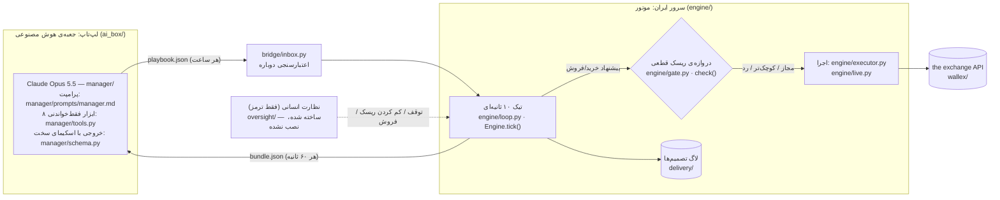

# راهنمای داوران — از `git clone` تا دیدن نتایج در چند دقیقه

**خلاصه:** یک دستور، بدون هیچ کلید API و بدون اینترنت (بعد از نصب)، چهار ادعای اصلی این مستند را از روی داده‌ی واقعی صرافی⁤⁤⁤⁤⁤⁤⁤⁤⁤⁤⁤⁤⁤⁤⁤⁤⁤⁤⁤⁣ و لاگ‌های واقعی مسابقه دوباره می‌سازد و کنار عدد ثبت‌شده در مخزن چاپ می‌کند. کدی که این گزارش‌ها اجرا می‌کنند همان موتوری است که با پول واقعی معامله کرد (`engine/`).

English summary at the end.

---

## ۱. اجرا (حدود ۱۰ دقیقه، بدون کلید)

پیش‌نیاز فقط [uv](https://docs.astral.sh/uv/) است (خودش Python 3.12 را هم نصب می‌کند):

```powershell
# Windows (PowerShell)
powershell -ExecutionPolicy ByPass -c "irm https://astral.sh/uv/install.ps1 | iex"
```
```bash
# Linux / macOS
curl -LsSf https://astral.sh/uv/install.sh | sh
```

بعد (روی هر سه سیستم‌عامل یکسان):

```bash
git clone https://github.com/MetaParsa/kestrel.git
cd kestrel
uv sync                              # نصب وابستگی‌ها (تنها مرحله‌ای که اینترنت می‌خواهد)
uv run python -m judge.demo          # ≈ ۸–۱۰ دقیقه؛ خروجی: judge_out/RESULTS.md
uv run python -m judge.film --open   # ≈ ۱۵ ثانیه: صفحه‌ی قدم‌به‌قدمِ موتور واقعی روی دقیقه‌های واقعی صرافی⁤⁤⁤⁤⁤⁤⁤⁤⁤⁤⁤⁤⁤⁤⁤⁤⁤⁤⁤⁣
uv run pytest -q                     # بیش از ۲۷۰ تست، کمتر از یک دقیقه
```

| گزینه | زمان | چه می‌کند |
|---|---|---|
| `uv run python -m judge.demo --quick` | ≈ ۲–۳ دقیقه | همه به‌جز بک‌تست |
| `uv run python -m judge.demo` | ≈ ۸–۱۰ دقیقه | + اولین پنجره‌ی ۳ روزه‌ی بک‌تست (۱ از ۲۵) |
| `uv run python -m judge.demo --windows 25` | ≈ ۸ دقیقه × (۲۵ ÷ تعداد هسته‌ها) | هر ۲۵ پنجره‌ی بک‌تست، موازی |

`judge.demo` چه می‌کند:
1. داده‌ی ثبت‌شده در مخزن (`data/sample/`: کندل‌های ۱ دقیقه‌ای واقعی صرافی⁤⁤⁤⁤⁤⁤⁤⁤⁤⁤⁤⁤⁤⁤⁤⁤⁤⁤⁤⁣ برای USDTTMN، BTCTMN و BTCUSDT، ۲۲ سپتامبر تا ۲۳ اکتبر ۲۰۲۶، حدود ۳ مگابایت) را با SHA-256 در `data/sample/MANIFEST.json` چک می‌کند؛
2. چهار گزارش را هر کدام در یک پردازه‌ی جدا، داخل پوشه‌ی موقت `judge_out/` اجرا می‌کند (هیچ فایل ثبت‌شده‌ای بازنویسی نمی‌شود)؛
3. عدد ثبت‌شده در `reports/out/*.json` را کنار عدد بازسازی‌شده چاپ می‌کند و در `judge_out/RESULTS.md` می‌نویسد.

| ادعا | اسکریپت | شاهد ثبت‌شده | عدد |
|---|---|---|---|
| هوش مصنوعی‌ای که به خودش نمره می‌دهد | `reports/self_grading.py` | [`delivery/SELF-GRADING.md`](delivery/SELF-GRADING.md) | <!-- SG:fa_short -->۷۲ پیش‌بینی ۴ ساعته (دو در هر برنامه): Claude ۴۶٪، مبنای ساده ۳۳٪، «همیشه خنثی» ۴۲٪؛ در ۴۶ برنامه از ۵۳ Claude به کارنامه‌ی خودش استناد کرد<!-- /SG --> |
| گروه کنترل (همان موتور، همان دقیقه‌ها، قاعده به‌جای Claude) | `reports/ab_replay.py` | [`delivery/CONTROL-GROUP.md`](delivery/CONTROL-GROUP.md) | بعد از فروش به تومان هر دو ⁦+۰٫۰۱۴٪⁩؛ افت ۰٫۰۲۶٪ در برابر ۰٫۱۷۷٪؛ کارمزد ۶۰۱ در برابر ۴٬۸۷۹ تومان |
| کمربند ایمنی (آزمون سقوط) | `reports/crash_drill.py` | [`delivery/SEATBELT.md`](delivery/SEATBELT.md) | سقوط ۱۰٪: با کمربند ⁦−۰٫۷۷٪⁩، بدون آن ⁦−۱٫۹۷٪⁩؛ قیمت خراب ⁦−۳۰٪⁩: هیچ فروشی |
| بک‌تست با همان موتور | `reports/backtest.py` | [`reports/out/backtest-summary.json`](reports/out/backtest-summary.json) | ۲۵ پنجره‌ی ۳ روزه: میانگین ⁦−۰٫۱۴٪⁩، بدترین افت ۰٫۶۰٪، همه تمام‌تومان |

در اجرای ما روی ویندوز با یک کلون تازه، همه‌ی اعداد دقیقاً تکرار شدند (جدول کامل در [`delivery/JUDGE-DEMO.md`](delivery/JUDGE-DEMO.md)).

---

### اجرای کامل عامل روی سیستم خودتان (اختیاری، با قیمت زنده‌ی صرافی⁤⁤⁤⁤⁤⁤⁤⁤⁤⁤⁤⁤⁤⁤⁤⁤⁤⁤⁤⁣ و پول شبیه‌سازی)

```bash
uv run python -m judge.try_live                  # ۱۰ دقیقه با مدیر قاعده‌محور رایگان؛ بدون هیچ کلیدی
uv sync --extra manager                          # فقط برای Claude: SDK انتروپیک
uv run python -m judge.try_live --claude         # با Claude واقعی؛ ANTHROPIC_API_KEY لازم است (حدود ۰٫۰۵ تا ۰٫۱۱ دلار هر برنامه، سقف ۳ دلار)
```
همان دو پردازه‌ای که در مسابقه کار کردند کنار هم اجرا می‌شوند: موتور در حالت سایه (دفتر سفارش عمومی صرافی⁤⁤⁤⁤⁤⁤⁤⁤⁤⁤⁤⁤⁤⁤⁤⁤⁤⁤⁤⁣ هر ۵ ثانیه، تیک ۱۰ ثانیه‌ای، پر شدن فقط وقتی معامله‌ی واقعی از قیمت ما عبور کند؛ این حالت اصلاً نمی‌تواند سفارش واقعی ثبت کند) و جعبه‌ی هوش مصنوعی که برنامه می‌نویسد. هر دقیقه وضعیت چاپ می‌شود و در پایان لاگ تصمیم فارسی در `judge_out/live/delivery/DECISIONS-try.md` ساخته می‌شود. در آزمون ما روی یک کلون تازه، در ۳ دقیقه برنامه آمد، یک خرید ۵٪ ثبت و پر شد و لاگ ساخته شد. چون مسابقه تمام شده، این اجرا پایان خودش را ۳ روز بعد می‌گذارد. نیاز به دسترسی به `api.wallex.ir` دارد (و با `--claude` به Anthropic).

## ۲. کجا را ببینیم (نقشه‌ی کد)



| می‌خواهید ببینید… | فایل |
|---|---|
| قلب موتور: هر ۱۰ ثانیه چه اتفاقی می‌افتد (به ترتیب) | [`engine/loop.py`](engine/loop.py) — `Engine.tick()`، توضیح مراحل در بالای فایل |
| دروازه‌ی ریسک که Claude نمی‌تواند دورش بزند | [`engine/gate.py`](engine/gate.py) — `check()`؛ همه‌ی عددها در [`config.py`](config.py) |
| آنچه Claude دقیقاً می‌خواند | [`manager/prompts/manager.md`](manager/prompts/manager.md) (پرامپت)، [`manager/tools.py`](manager/tools.py) (۸ ابزار)، [`manager/schema.py`](manager/schema.py) (خروجی و محدودسازی) |
| حلقه‌ی ابزار Claude و سقف هزینه | [`manager/manager.py`](manager/manager.py)، [`ai_box/loop.py`](ai_box/loop.py)، [`ai_box/spend.py`](ai_box/spend.py) |
| کارنامه‌ی پیش‌بینی که به Claude برمی‌گردد | [`manager/scorecard.py`](manager/scorecard.py) |
| سهم هدف، حد ضرر، فروش پایانی | [`engine/core.py`](engine/core.py)، [`engine/exits.py`](engine/exits.py)، [`engine/flatten.py`](engine/flatten.py) |
| سفارش واقعی و دو قفل پول واقعی | [`engine/live.py`](engine/live.py)، [`wallex/trading.py`](wallex/trading.py)، [`engine/canary.py`](engine/canary.py) |
| دوقلوی قاعده‌محور (گروه کنترل) | [`manager/mock.py`](manager/mock.py) |
| هر تصمیم زنده با دلیل فارسی | [`delivery/DECISIONS-live.md`](delivery/DECISIONS-live.md)؛ سایه: [`DECISIONS-main.md`](delivery/DECISIONS-main.md)؛ دوقلو: [`DECISIONS-baseline.md`](delivery/DECISIONS-baseline.md) |
| لاگ خام (هر سطر با `git_sha`) | [`delivery/server-logs/main/logs/`](delivery/server-logs/main/logs/) — `decisions`، `orders`، `fills`، `playbooks`، `events` |
| گفت‌وگوی کامل Claude با ابزارها در هر چرخه | [`delivery/ai-box/transcript-*.json`](delivery/ai-box/)؛ دفتر هزینه: [`spend.jsonl`](delivery/ai-box/spend.jsonl) |
| آزمون فشار پرامپت (۹ سناریو، شامل تزریق دستور) | [`delivery/PROMPT-STRESS.md`](delivery/PROMPT-STRESS.md) |
| نظارت انسانی (فقط ترمز، نصب‌نشده) | [`oversight/README.md`](oversight/README.md) |

---

## ۳. کدام کد معامله کرد؟

- هر سطر لاگ شناسه‌ی کامیت (`git_sha`) را دارد و هر نسخه‌ای که روی سرور با پول واقعی کار کرد یک تگ `live-*` دارد (`git tag -n1 -l "live-*"`):
  - [`live-v1`](https://github.com/MetaParsa/kestrel/tree/live-v1) (`301364b`) — شروع زنده، جمعه ۱ آبان ۰۱:۲۰ تهران؛
  - [`live-v2`](https://github.com/MetaParsa/kestrel/tree/live-v2) (`10bc993`) — از حدود ۱۲:۳۰: دو ایرادی که آزمون سقوط پیدا کرد؛
  - [`live-v3`](https://github.com/MetaParsa/kestrel/tree/live-v3) (`e123198`) — عصر جمعه: پنجره‌ی فروش پایانی کوتاه‌تر (`WALLEX_FLATTEN_H`): خرید تا ۲۱:۲۰، همه‌چیز تومان تا ۲۳:۲۰؛
  - [`live-v4`](https://github.com/MetaParsa/kestrel/tree/live-v4) (`0e2d29b`) — از حدود ۱۷:۴۵: در عصر آخر هر ۱۵ دقیقه از Claude برنامه خواسته می‌شود (`a808dc7`)؛ پوشه‌های `judge/` و `oversight/` هم در این نسخه هستند اما موتور آن‌ها را import یا اجرا نمی‌کند.
  - [`live-v5`](https://github.com/MetaParsa/kestrel/tree/live-v5) (`84a5214`) — از حدود ۱۹:۵۰: **قفل سود** (`WALLEX_PROFIT_LOCK=0.0003`): اگر دارایی منهای هزینه‌ی فروش همه‌چیز به ⁦+۰٫۰۳٪⁩ برسد، همه‌چیز فروخته و خرید تا پایان بسته می‌شود.
- هر تغییر بعدی در مسیر معامله: `git log --oneline live-v5..HEAD -- engine wallex bridge ai_box manager config.py deploy`.
- تغییرهای سمت لپ‌تاپ در طول مسابقه کامیت‌های جدا دارند: پرامپت (`75c2700` حداقل سفارش و نمره‌ی فعالیت، `612c972`، `13730f6` راهنمای صاحب حساب برای عصر جمعه)، نمای دوقلو برای Claude (`79d2f13`، پرامپت و `ai_box/`)، فاصله‌ی ۱۵ دقیقه‌ای و کش ۱ ساعته‌ی پرامپت در عصر آخر (`a808dc7`)، و ویرایش‌های عصر جمعه (`c9f9c01` لحن خنثی، `84a5214` قفل سود، `a1f2f05`). هیچ‌کدام به دروازه‌ی ریسک دست نزدند و تصمیم هر بار با خود Claude ماند.

## ۴. نقشه‌ی معیارهای فنی داوری → شاهد

| معیار | کجا ببینید |
|---|---|
| منطق استراتژی (۴۰) | [`STRATEGY.md`](STRATEGY.md) بخش ۱ و ۳؛ [`config.py`](config.py) (رژیم‌ها و محدوده‌ها)؛ [`engine/core.py`](engine/core.py) |
| استفاده‌ی واقعی از هوش مصنوعی (۳۵) | پرامپت و ابزارها؛ رونوشت‌های [`delivery/ai-box/`](delivery/ai-box/)؛ [`SELF-GRADING.md`](delivery/SELF-GRADING.md)؛ [`CONTROL-GROUP.md`](delivery/CONTROL-GROUP.md)؛ [`PROMPT-STRESS.md`](delivery/PROMPT-STRESS.md) |
| مدیریت ریسک و سرمایه (۳۰) | [`engine/gate.py`](engine/gate.py)؛ [`SEATBELT.md`](delivery/SEATBELT.md)؛ `tests/test_gate.py` |
| قابلیت اجرای مجدد (۲۵) | همین صفحه: `judge.demo` + `pytest`؛ [`deploy/`](deploy/) برای سرور |
| بک‌تست و تست سایه (۲۰) | [`reports/backtest.py`](reports/backtest.py)؛ [`STRATEGY.md`](STRATEGY.md) بخش ۵؛ [`DECISIONS-main.md`](delivery/DECISIONS-main.md) (سایه) |
| پایداری (۱۵) | نردبان احتیاط و واچ‌داگ: [`engine/loop.py`](engine/loop.py)، [`alerts/watchdog.py`](alerts/watchdog.py)؛ `tests/test_loop.py` |
| افت سرمایه (۳۰) | زنده: جدول بخش زنده‌ی [`STRATEGY.md`](STRATEGY.md) (از لاگ سرور)؛ بک‌تست: بدترین ۰٫۶۰٪؛ حد −۳٪ فروش همه‌چیز |

## ۵. صادقانه
- حساب پراپ فقط BTCTMN را پذیرفت؛ زنده دیر شروع شد (بامداد روز آخر) و Claude محتاط بود. فروش پایانی اول (۱۵:۵۵) حساب را روی ۵٬۰۰۰٬۴۱۰ تومان بست؛ عصر خرید دوباره باز شد (`live-v3`)، یک خرید ۱۷:۴۰ با تصمیم «ریسک‌گریز» Claude ساعت ۱۹:۳۲ با زیان کوچک فروخته شد. عدد نهایی در بخش زنده‌ی `STRATEGY.md` است.
- بک‌تست با دوقلوی قاعده‌محور است، نه Claude (Claude را نمی‌شود صادقانه روی گذشته اجرا کرد). ارزش Claude با گروه کنترل و کارنامه‌ی پیش‌بینی سنجیده می‌شود، و نمونه‌ها کوچک‌اند.
- `judge.demo` نشان می‌دهد عددها از همین کد و داده تکرار می‌شوند (تکرارپذیری)، نه اینکه استراتژی خوب است؛ و گزارش‌ها را بازسازی می‌کند، نه تماس با Claude را؛ برنامه‌های Claude همان‌هایی هستند که در زنده ثبت شدند.
- در گروه کنترل، کمتر بودن افت و کارمزد Claude بیشتر از سهم کوچک‌ترش می‌آید (۴٪ در برابر ۱۵٪): همان نتیجه با یک‌چهارم ریسک، نه معامله‌ی بهتر.
- حد ضرر و فروش اضطراری نرم‌افزاری‌اند (هر ۱۰ ثانیه)، نه سفارش نشسته روی صرافی؛ اگر سرور قطع شود واچ‌داگ فقط هشدار می‌دهد.
- در آزمون فشار پرامپت، چند سناریو را یک خروجی ثابت «همان ۴٪ را نگه دار» هم قبول می‌شد؛ سناریوهای معنادار سقوط، تزریق دستور و کارنامه‌ی بد هستند.
- لایه‌ی تاکتیکی (`tactical` در `engine/exits.py` و `engine/gate.py`) در کد هست اما در زنده خاموش بود (`tactical_allowed` همیشه false)، چون آزمون walk-forward آن انجام نشد. توضیح‌هایی مثل `spec v2 §…` در کد به مستند طراحی بیرون از مخزن اشاره می‌کنند.
- زمان دقیق پایان مسابقه از برگزارکننده تأیید نشد؛ موتور محتاط‌ترین زمان (جمعه ۲۳:۵۰ تهران، `WALLEX_END_AT`) را فرض کرد.

---

## English summary

**One command, no API key, no network after install:**
```bash
git clone https://github.com/MetaParsa/kestrel.git && cd kestrel
uv sync
uv run python -m judge.demo          # ~8–10 min → judge_out/RESULTS.md (--quick: ~3 min, --windows 25: full backtest)
uv run pytest -q                     # 250+ tests, ~25 s
```
It verifies the committed the exchange⁤⁤⁤⁤⁤⁤⁤⁤⁤⁤⁤⁤⁤⁤⁤⁤⁤⁤⁣ 1-minute candles (`data/sample/`, SHA-256 manifest), then re-runs the four evidence reports — self-grading forecasts, the control-group replay (Claude's recorded playbooks vs the rule-based twin on the same engine and minutes), the crash drill, and a backtest window — each in its own process inside `judge_out/`, and prints the committed number next to the reproduced one. On a fresh Windows clone every number matched exactly ([`delivery/JUDGE-DEMO.md`](delivery/JUDGE-DEMO.md)).

**Run the whole agent yourself (optional, live the exchange⁤⁤⁤⁤⁤⁤⁤⁤⁤⁤⁤⁤⁤⁤⁤⁤⁤⁤⁣ prices, simulated money):** `uv run python -m judge.try_live` (free rule-based manager, 10 min, no key) or `uv sync --extra manager` then `uv run python -m judge.try_live --claude` with `ANTHROPIC_API_KEY` set (≈ $0.05–0.11 per plan, $3 cap). It starts the engine in shadow mode (cannot place real orders) and the AI box side by side, prints the status every minute and writes the Persian decision log to `judge_out/live/delivery/DECISIONS-try.md`. Needs access to `api.wallex.ir`.

**Where to look:** the 10-second tick is `Engine.tick()` in [`engine/loop.py`](engine/loop.py); the risk gate Claude can't override is `check()` in [`engine/gate.py`](engine/gate.py) with every limit in [`config.py`](config.py); Claude's prompt is [`manager/prompts/manager.md`](manager/prompts/manager.md) with 8 read-only tools in [`manager/tools.py`](manager/tools.py); every live decision with its Persian reason is in [`delivery/DECISIONS-live.md`](delivery/DECISIONS-live.md), raw logs (each line with its `git_sha`) in `delivery/server-logs/`, and Claude's full tool transcripts in `delivery/ai-box/`.

**What traded:** every live deployment has a `live-*` tag — `live-v1` (`301364b`), `live-v2` (`10bc993`), `live-v3` (`e123198`, buying reopened until 21:20), `live-v4` (`0e2d29b`, manager every ~11 min on the last evening; also carries `judge/` and `oversight/`, which the engine never imports), `live-v5` (`84a5214`, profit lock at +0.03 % net). Laptop-side prompt edits are separate commits (`75c2700`, `612c972`, `79d2f13`, `13730f6`, `a808dc7`, `c9f9c01`, `84a5214`, `a1f2f05`). **Demo film:** `uv run python -m judge.film --open` steps through the real engine on real the exchange⁤⁤⁤⁤⁤⁤⁤⁤⁤⁤⁤⁤⁤⁤⁤⁤⁤⁤⁣ minutes (Claude's real plans, a rogue 90 % plan, a −30 % bad print, a human `/risk`, the sell-off, a 10 % crash). **Human oversight** (`oversight/`: Bale `/pause`, `/risk`, `/flatten`, `/resume`, `/review`, all logged with who/when/why) is built and tested but was not deployed; it can only make the engine more careful, never place or size a trade, as the contest rules require.
