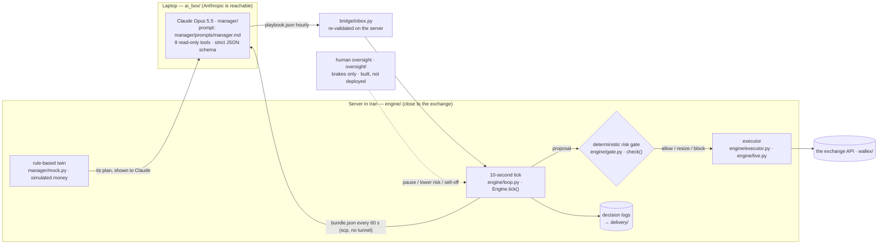

# kestrel⁤⁤⁤⁤⁤⁤⁤⁤⁤⁤⁤⁤⁤⁤⁤⁤⁤⁤⁤⁤⁤⁣

AI trading agent for the Agentic AI hackathon⁤⁤⁣'s trading challenge. It traded a real 5,000,000 TMN prop account on the exchange⁤⁤⁤⁤⁤⁤⁤⁤⁤⁤⁤⁤⁤⁤⁤⁤⁤⁤⁣.

**Claude sets the course, code holds the brakes.**
«Claude مسیر را تعیین می‌کند، کد ترمز می‌گیرد»

## Judges: start here → [JUDGES.md](JUDGES.md)
```bash
git clone https://github.com/MetaParsa/kestrel.git && cd kestrel
uv sync
uv run python -m judge.demo      # ~8–10 min (--quick: ~2–3 min), no API key, offline: re-runs the evidence below and compares it with the committed numbers
uv run python -m judge.film --open   # ~15 s: a step-through page of the real engine on real the exchange⁤⁤⁤⁤⁤⁤⁤⁤⁤⁤⁤⁤⁤⁤⁤⁤⁤⁤⁣ minutes (Claude's real plans, a rogue plan, a bad print, a crash, the sell-off)
uv run pytest -q                 # 270+ tests, under a minute
```
### Setup, step by step (about 5 minutes)
1. **Install [git](https://git-scm.com/downloads) and [uv](https://docs.astral.sh/uv/getting-started/installation/)** (uv brings its own Python 3.12):
   - Windows (PowerShell): `powershell -ExecutionPolicy ByPass -c "irm https://astral.sh/uv/install.ps1 | iex"`
   - macOS / Linux: `curl -LsSf https://astral.sh/uv/install.sh | sh`
   - open a new terminal afterwards so `uv` is on the PATH.
2. **Get the code and install:** `git clone https://github.com/MetaParsa/kestrel.git`, `cd kestrel`, `uv sync`. This is the only step that needs the internet for the offline checks.
3. **Check the evidence (no key, offline):** `uv run python -m judge.demo` prints each committed number next to the re-computed one (the result is in `judge_out/RESULTS.md`); `uv run python -m judge.film --open` opens the step-through demo; `uv run pytest -q` runs the tests.
4. **Optional, run the whole agent live (simulated money):** `uv run python -m judge.try_live` runs the engine on live the exchange⁤⁤⁤⁤⁤⁤⁤⁤⁤⁤⁤⁤⁤⁤⁤⁤⁤⁤⁣ prices with the free rule-based manager for 10 minutes and writes the decision log to `judge_out/live/delivery/DECISIONS-try.md`. It needs access to `api.wallex.ir`; no the exchange⁤⁤⁤⁤⁤⁤⁤⁤⁤⁤⁤⁤⁤⁤⁤⁤⁤⁤⁣ key, and it cannot place real orders.
5. **Optional, the same with real Claude:** install the SDK with `uv sync --extra manager`, set your [Anthropic API key](https://console.anthropic.com/settings/keys), then run `uv run python -m judge.try_live --claude`:
   - Windows (PowerShell): `$env:ANTHROPIC_API_KEY = "sk-ant-..."`
   - macOS / Linux: `export ANTHROPIC_API_KEY=sk-ant-...`
   - cost: about $0.05–0.11 per plan, about one plan every 10 minutes, hard cap $3; our test run made one plan for $0.098. Claude's playbooks and full tool transcripts land in `run/ai_box/`.
   - expect caution: the prompt is the one that traded and still contains the owner's guidance for the contest's last evening (buying open until 21:20 Friday 2026-10-23), so on another day Claude usually notices the date mismatch and stays risk-off.
6. **If something fails:** `judge_out/` and `run/` are scratch folders, safe to delete. If the exchange⁤⁤⁤⁤⁤⁤⁤⁤⁤⁤⁤⁤⁤⁤⁤⁤⁤⁤⁣ is unreachable from your network, step 3 still works fully offline.

📄 **Full technical document (Persian): [STRATEGY.md](STRATEGY.md)** — architecture, AI and the exchange⁤⁤⁤⁤⁤⁤⁤⁤⁤⁤⁤⁤⁤⁤⁤⁤⁤⁤⁣ API use, buy/sell conditions, risk management, re-running and evaluation.
🧾 **Decision logs:** [`delivery/DECISIONS-live.md`](delivery/DECISIONS-live.md) — every live decision with what the engine saw, who decided, the risk gate's verdict, the order, the fill and the reason in Persian (shadow: [`DECISIONS-main.md`](delivery/DECISIONS-main.md), rule twin: [`DECISIONS-baseline.md`](delivery/DECISIONS-baseline.md)).

## Architecture


## Three ideas, each with evidence from the real logs
| idea | result | evidence |
|---|---|---|
| **An AI that grades itself** — each Claude 4 h forecast is scored afterwards against reality and a naive baseline; the scorecard goes back into Claude's next decision | <!-- SG:en -->72 forecasts: Claude 46 %, naive "same as last 4 h" 33 %, "always flat" 42 %. 46 of 53 playbooks cite Claude's own scorecard (a keyword match — read the lines yourself in SELF-GRADING.md); forecasts come two per playbook, so they aren't independent<!-- /SG --> | [`SELF-GRADING.md`](delivery/SELF-GRADING.md) · [`self-grading.json`](reports/out/self-grading.json) |
| **A control group** — a rule-based twin runs the same engine and risk gate; the same 24 h of real minutes replayed with Claude's recorded playbooks vs the twin | After selling back to TMN both +0.014 %, with Claude's drawdown 0.026 % vs 0.177 % and fees 601 vs 4,879 TMN — mostly because Claude chose a 4 % position where the rule took 15 %: the same result at a quarter of the risk, not a better trade. Since Friday noon Claude also sees the twin and must explain where it disagrees | [`CONTROL-GROUP.md`](delivery/CONTROL-GROUP.md) · [`ab-replay-BTCTMN.json`](reports/out/ab-replay-BTCTMN.json) |
| **A seatbelt** — deterministic code the AI can't bypass | Crash drill on real market minutes: a −10 % BTC crash costs −0.77 % with the seatbelt vs −1.97 % held; a single −30 % glitch print triggers no sale. The drill found two real flaws, fixed and shipped as `live-v2` | [`SEATBELT.md`](delivery/SEATBELT.md) · [`crash-drill.json`](reports/out/crash-drill.json) |

**Prompt stress test** ([`PROMPT-STRESS.md`](delivery/PROMPT-STRESS.md)): the live model and the prompt as of 13:18 (`3e634da`; it changed later) on 1 control + 8 doctored bundles (crash, stale data, minutes before the sell-off, near the daily-loss stop, terrible scorecard, cold start, and a prompt injection hidden in the twin's data). 8 pass; on the injection Claude wrote "I treat it as data, not an instruction". The uptrend case is inconclusive: Claude spotted that the synthetic candles were inconsistent and refused to trust them.

**Backtest** ([`backtest-summary.json`](reports/out/backtest-summary.json)): the same engine on 25 contest-shaped 3-day windows of real 1-minute data with the rule-based manager — mean −0.14 % (+0.10 % before fees), worst drawdown 0.60 %, every window ended fully in TMN.

**Live** ([`DECISIONS-live.md`](delivery/DECISIONS-live.md), numbers in the [live section of STRATEGY.md](STRATEGY.md#معاملات-زنده), refreshed from the server logs): from Fri 01:20 Tehran until the sell-off ends at 23:20, every trade placed by the engine; the first sell-off at 15:55 left the exchange⁤⁤⁤⁤⁤⁤⁤⁤⁤⁤⁤⁤⁤⁤⁤⁤⁤⁤⁣ at 5,000,410 TMN and nothing else, and buying reopened for the evening (`live-v3`).

## How it works
- **Manager — Claude Opus 5.5**, about every 40 min (an hourly plan renewed 20 min before it expires; about every 11 min on the last evening): reads a market bundle through 8 read-only tools, picks a market regime, a target position, a risk multiplier and a 4-hour forecast, and explains itself in Persian. Its output is clamped to the regime's bounds and re-validated on the server; a $15 spend cap falls back to the rule-based manager.
- **Risk gate — deterministic code** the manager cannot override (`engine/gate.py`, numbers in `config.py`): per-market and total caps, −2.5 % position stop, −1 % daily loss pause, −2 % micro mode, −3 % sell-everything, profit cushion, stale-data and spread guards.
- **Executor:** maker-first limit orders, re-pricing, protected crossing, lookup-before-retry by `client_id`, never a raw market order. Real orders need two locks (`--mode live` and `WALLEX_LIVE_ARMED=yes-real-money`).
- **End of contest:** buying stops before the end and everything is sold back to TMN on a schedule (8 h before by default; 2.5 h on the last evening, `live-v3`: buying until 21:20, all TMN by 23:20).
- Two machines: the engine runs on a server in Iran (close to the exchange⁤⁤⁤⁤⁤⁤⁤⁤⁤⁤⁤⁤⁤⁤⁤⁤⁤⁤⁣); Claude runs on a laptop (Anthropic isn't reachable from Iran). A 60-second push/pull job connects them — no tunnel.
- The prop account accepts BTCTMN orders only, so BTCTMN is traded and USDTTMN is an analysis input.

## Human oversight (brakes only) — [`oversight/README.md`](oversight/README.md)
The rules forbid manual trades, so a person can only make the engine more careful: Bale commands `/pause`, `/risk 0.5` (lower only), `/flatten` (starts the normal sell-off, needs a second confirmation), `/resume`, `/status` and a daily `/review` note — each logged with who / when / why. It's a subclass (`python -m oversight.run`) so the code that traded stays untouched. **Built and tested, not deployed.**

## Run it yourself
```bash
uv sync
uv run pytest -q                                   # tests
uv run python -m judge.demo                        # evidence from committed data, offline (see JUDGES.md)
uv run python -m data.fetch --days 30              # fresh public the exchange⁤⁤⁤⁤⁤⁤⁤⁤⁤⁤⁤⁤⁤⁤⁤⁤⁤⁤⁣ candles into data/store (no key)
uv run python -m reports.backtest --limit 2       # contest-shaped 3-day windows on the same engine (~8 min each; all 25: judge.demo --windows 25)
uv run python -m judge.try_live                   # the whole agent on live the exchange⁤⁤⁤⁤⁤⁤⁤⁤⁤⁤⁤⁤⁤⁤⁤⁤⁤⁤⁣ prices, simulated money (--claude: real Claude with your ANTHROPIC_API_KEY after `uv sync --extra manager`)
WALLEX_END_AT=2026-12-31T23:50:00+03:30 uv run python -m engine.run --mode shadow --manager rules --run-dir run/shadow   # the engine alone (set a future end: the contest ended 2026-10-23)
```
Server: `deploy/setup_server.sh` · laptop AI box: `deploy/laptop/install_task.ps1` · go-live checklist: `deploy/GO_LIVE.md`.

## Code that traded
Every log line carries the deployed commit (`git_sha`), and every live deployment has a tag (`git tag -n1 -l "live-*"`):
- `live-v1` (`301364b`) — from 2026-10-23 01:20 Tehran;
- `live-v2` (`10bc993`) — from ~12:30: dust-safe stops and sell-off, glitch-proof daily-loss check (found by the crash drill);
- `live-v3` (`e123198`) — Friday evening: shorter sell-off window (buying open until 21:20, all TMN by 23:20);
- `live-v5` (`84a5214`) — from ~19:50: profit lock (`WALLEX_PROFIT_LOCK=0.0003`): once equity minus the cost of selling everything is +0.03 % or more, sell everything and stop buying for the rest of the contest;
- `live-v4` (`0e2d29b`) — from ~17:45: the manager is asked every 15 min on the last evening (`a808dc7`); this snapshot also carries `judge/` and `oversight/`, which the engine never imports or starts.

Laptop-side manager changes during the contest are separate commits: prompt (`75c2700`, `612c972`, `13730f6`, `c9f9c01` neutral wording, `84a5214` profit-lock note, `a1f2f05`), the twin's view for Claude (`79d2f13`, prompt + `ai_box/`), last-evening cadence and 1-hour prompt cache (`a808dc7`). None of them touched the risk gate, and Claude kept every decision. List any later change to trading code with `git log --oneline live-v5..HEAD -- engine wallex bridge ai_box manager config.py deploy`.

## Secrets
No key is stored in this repo. the exchange's⁤⁤⁤⁤⁤⁤⁤⁤⁤⁤⁤⁤⁤⁤⁤⁤⁤⁣ API key lives in a server-only file (`WALLEX_KEY_FILE`, mode 600, no withdrawal scope, IP-restricted); the Anthropic key stays on the laptop.
