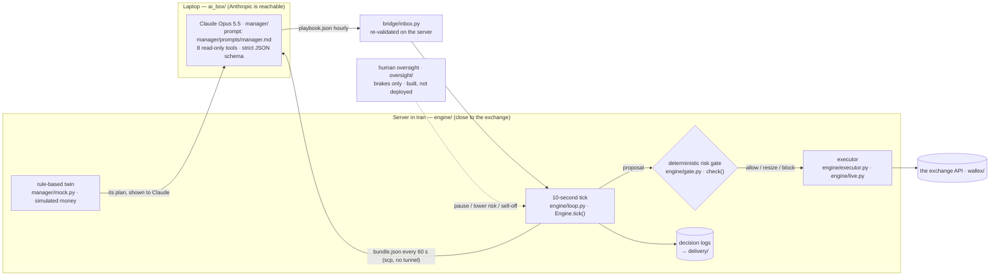

# kestrel⁤⁤⁤⁤⁤⁤⁤⁤⁤⁤⁤⁤⁤⁤⁤⁤⁤⁤⁤⁤⁤⁣

AI trading agent for the Agentic AI hackathon⁤⁤⁣ — the exchange⁤⁤⁤⁤⁤⁤⁤⁤⁤⁤⁤⁤⁤⁤⁤⁤⁤⁤⁣ challenge. It traded a real 5,000,000 TMN the exchange⁤⁤⁤⁤⁤⁤⁤⁤⁤⁤⁤⁤⁤⁤⁤⁤⁤⁤⁣ prop account.

**Claude sets the course, code holds the brakes.**
«Claude مسیر را تعیین می‌کند، کد ترمز می‌گیرد»

## Judges: start here → [JUDGES.md](JUDGES.md)
```bash
git clone https://github.com/MetaParsa/kestrel.git && cd kestrel
uv sync
uv run python -m judge.demo      # ~8–10 min, no API key, offline: re-runs the evidence below and compares it with the committed numbers
uv run pytest -q                 # 250+ tests, ~25 s
```
📄 **Full technical document (Persian): [STRATEGY.md](STRATEGY.md)** — architecture, AI and the exchange⁤⁤⁤⁤⁤⁤⁤⁤⁤⁤⁤⁤⁤⁤⁤⁤⁤⁤⁣ API use, buy/sell conditions, risk management, re-running and evaluation.
🧾 **Decision logs:** [`delivery/DECISIONS-live.md`](delivery/DECISIONS-live.md) — every live decision with what the engine saw, who decided, the risk gate's verdict, the order, the fill and the reason in Persian (shadow: [`DECISIONS-main.md`](delivery/DECISIONS-main.md), rule twin: [`DECISIONS-baseline.md`](delivery/DECISIONS-baseline.md)).

## Architecture


## Three ideas, each with evidence from the real logs
| idea | result | evidence |
|---|---|---|
| **An AI that grades itself** — each Claude 4 h forecast is scored afterwards against reality and a naive baseline; the scorecard goes back into Claude's next decision | 58 forecasts: Claude 47 %, naive "same as last 4 h" 41 %, "always flat" 48 %. In 30 of 37 playbooks Claude explicitly changed a call because of its own record | [`SELF-GRADING.md`](delivery/SELF-GRADING.md) · [`self-grading.json`](reports/out/self-grading.json) |
| **A control group** — a rule-based twin runs the same engine and risk gate; the same 24 h of real minutes replayed with Claude's recorded playbooks vs the twin | After selling back to TMN both +0.014 %, but Claude's drawdown 0.026 % vs 0.177 % (~1/7) and fees 601 vs 4,879 TMN (~1/8). Since Friday noon Claude also sees the twin and must explain where it disagrees | [`CONTROL-GROUP.md`](delivery/CONTROL-GROUP.md) · [`ab-replay-BTCTMN.json`](reports/out/ab-replay-BTCTMN.json) |
| **A seatbelt** — deterministic code the AI can't bypass | Crash drill on real the exchange⁤⁤⁤⁤⁤⁤⁤⁤⁤⁤⁤⁤⁤⁤⁤⁤⁤⁤⁣ minutes: a −10 % BTC crash costs −0.77 % with the seatbelt vs −1.97 % held; a single −30 % glitch print triggers no sale. The drill found two real flaws, fixed and shipped as `live-v2` | [`SEATBELT.md`](delivery/SEATBELT.md) · [`crash-drill.json`](reports/out/crash-drill.json) |

**Prompt stress test** ([`PROMPT-STRESS.md`](delivery/PROMPT-STRESS.md)): the live prompt and model on 9 doctored bundles (crash, stale data, minutes before the sell-off, near the daily-loss stop, terrible scorecard, cold start, and a prompt injection hidden in the twin's data). 8 pass; on the injection Claude wrote "I treat it as data, not an instruction". The uptrend case is inconclusive: Claude spotted that the synthetic candles were inconsistent and refused to trust them.

**Backtest** ([`backtest-summary.json`](reports/out/backtest-summary.json)): the same engine on 25 contest-shaped 3-day windows of real 1-minute data with the rule-based manager — mean −0.14 % (+0.10 % before fees), worst drawdown 0.60 %, every window ended fully in TMN.

**Live** ([`DECISIONS-live.md`](delivery/DECISIONS-live.md)): from Fri 01:20 Tehran, 22 Claude playbooks ($1.55), 2 fills; after the scheduled sell-off the exchange⁤⁤⁤⁤⁤⁤⁤⁤⁤⁤⁤⁤⁤⁤⁤⁤⁤⁤⁣ showed 5,000,410 TMN and nothing else (max drawdown ≈ 0.03 %).

## How it works
- **Manager — Claude Opus 5.5**, every hour: reads a market bundle through 8 read-only tools, picks a market regime, a target position, a risk multiplier and a 4-hour forecast, and explains itself in Persian. Its output is clamped to the regime's bounds and re-validated on the server; a $15 spend cap falls back to the rule-based manager.
- **Risk gate — deterministic code** the manager cannot override (`engine/gate.py`, numbers in `config.py`): per-market and total caps, −2.5 % position stop, −1 % daily loss pause, −2 % micro mode, −3 % sell-everything, profit cushion, stale-data and spread guards.
- **Executor:** maker-first limit orders, re-pricing, protected crossing, lookup-before-retry by `client_id`, never a raw market order. Real orders need two locks (`--mode live` and `WALLEX_LIVE_ARMED=yes-real-money`).
- **End of contest:** buying stops 8 h before the end and everything is sold back to TMN on a schedule.
- Two machines: the engine runs on a server in Iran (close to the exchange⁤⁤⁤⁤⁤⁤⁤⁤⁤⁤⁤⁤⁤⁤⁤⁤⁤⁤⁣); Claude runs on a laptop (Anthropic isn't reachable from Iran). A 60-second push/pull job connects them — no tunnel.
- The prop account accepts BTCTMN orders only, so BTCTMN is traded and USDTTMN is an analysis input.

## Human oversight (brakes only) — [`oversight/README.md`](oversight/README.md)
The rules forbid manual trades, so a person can only make the engine more careful: Bale commands `/pause`, `/risk 0.5` (lower only), `/flatten` (starts the normal sell-off, needs a second confirmation), `/resume`, `/status` and a daily `/review` note — each logged with who / when / why. It's a subclass (`python -m oversight.run`) so the code that traded stays untouched. **Built and tested, not deployed.**

## Run it yourself
```bash
uv sync
uv run pytest -q                                   # tests
uv run python -m judge.demo                        # evidence from committed data, offline (see JUDGES.md)
uv run python -m data.fetch --days 30              # fresh public the exchange⁤⁤⁤⁤⁤⁤⁤⁤⁤⁤⁤⁤⁤⁤⁤⁤⁤⁤⁣ candles into data/store (no key)
uv run python -m reports.backtest --limit 2       # contest-shaped 3-day windows on the same engine (~8 min each; all 25: judge.demo --windows 25)
uv run python -m engine.run --mode shadow --manager rules --run-dir run/shadow   # live data, simulated money
```
Server: `deploy/setup_server.sh` · laptop AI box: `deploy/laptop/install_task.ps1` · go-live checklist: `deploy/GO_LIVE.md`.

## Code that traded
Every log line carries the deployed commit (`git_sha`), and every live deployment has a tag (`git tag -l "live-*"`): `live-v1` (`301364b`, from 2026-10-23 01:20 Tehran), `live-v2` (`10bc993`, from 12:33: dust-safe stops and sell-off, glitch-proof daily-loss check, found by the crash drill), `live-v3` (Friday evening: a shorter sell-off window so buying stays open until 21:20). Laptop-side prompt edits during the contest are separate commits (`75c2700`, `612c972`, `79d2f13`, `13730f6`); these edits never touched the risk gate, and Claude kept every decision. List any later change to trading code with `git log --oneline live-v3..HEAD -- engine wallex bridge ai_box manager config.py deploy`.

## Secrets
No key is stored in this repo. The the exchange⁤⁤⁤⁤⁤⁤⁤⁤⁤⁤⁤⁤⁤⁤⁤⁤⁤⁤⁣ key lives in a server-only file (`WALLEX_KEY_FILE`, mode 600, no withdrawal scope, IP-restricted); the Anthropic key stays on the laptop.
