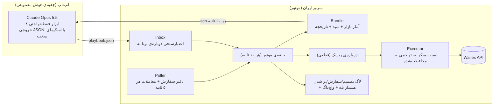

# موتور معاملاتی هوشمند والکس — مستند فنی

**«Claude مسیر را تعیین می‌کند، کد ترمز می‌گیرد.»**
تیم یک‌نفره (پارسا + Claude Code به‌عنوان ایجنت کدنویس) — چالش والکس، هکاتون Agentic AI استارکوچ، مهر/آبان ۱۴۰۵.

این مستند پنج بخشی را پوشش می‌دهد که صورت چالش خواسته است: (۱) معماری و منطق اصلی، (۲) نحوه‌ی استفاده از هوش مصنوعی و ابزارهای والکس، (۳) شرایط خرید و فروش، (۴) مدیریت سرمایه و ریسک، (۵) اجرای مجدد و ارزیابی. لاگ تصمیم‌ها و نتایج در پوشه‌ی `delivery/` است.

---

## ۰. خلاصه در یک نگاه

| | |
|---|---|
| بازار معامله | **BTCTMN** (بیت‌کوین/تومان). حساب پراپ سفارش USDTTMN را نمی‌پذیرد (پیام والکس: «امکان ثبت سفارش در بازار USDTTMN وجود ندارد»)، پس تتر/تومان فقط **ورودی تحلیل** است. |
| مغز تصمیم | Claude Opus 5.5، هر ساعت (و بعد از رویدادهای تند بازار) یک «برنامه» (playbook) می‌نویسد: رژیم بازار، سهم هدف، ضریب ریسک، پیش‌بینی ۴ ساعته، و دلیل به فارسی. |
| ترمز | یک «دروازه‌ی ریسک» قطعی (کد، نه مدل) که هیچ برنامه‌ای نمی‌تواند از آن رد شود: سقف حجم، حد ضرر، توقف روزانه، فروش اضطراری. |
| اجرا | سفارش لیمیت با اولویت میکر (کارمزد ۰٫۲۵٪ به‌جای ۰٫۳۰٪)، قیمت‌گذاری مجدد، و هیچ سفارش مارکت خام. |
| پایان | از ۸ ساعت مانده به پایان، خرید متوقف و همه‌چیز طبق برنامه به تومان فروخته می‌شود؛ ۳۰ دقیقه‌ی آخر فقط تطبیق و تأیید. |
| شفافیت | هر تصمیم با «چه دید، چه کسی تصمیم گرفت، دروازه‌ی ریسک چه گفت، چه سفارشی رفت، چه پر شد و چرا» ثبت می‌شود؛ هر سطر لاگ شناسه‌ی نسخه‌ی کد (`git_sha`) را دارد. |

---

## ۱. معماری و منطق اصلی



**چرا دو ماشین؟** سرور در ایران به API والکس نزدیک است اما به Anthropic دسترسی ندارد؛ لپ‌تاپ به Claude دسترسی دارد. پس موتور معامله روی سرور است و «مدیر» روی لپ‌تاپ. هیچ تونلی باز نیست: لپ‌تاپ هر ۶۰ ثانیه بسته‌ی وضعیت (bundle) را می‌کشد و برنامه را می‌فرستد.

**لایه‌ها:**

1. **داده** (`data/`, `wallex/client.py`): دفتر سفارش و آخرین معاملات هر ۵ ثانیه؛ کندل‌های ۱ دقیقه‌ای (۳۰ روز تاریخچه + به‌روزرسانی زنده). کتاب سفارش قفل‌شده/صفر رد می‌شود؛ بازاری که ۳۰ دقیقه معامله نداشته برای خرید «کهنه» حساب می‌شود.
2. **مدیر (Claude)** (`manager/`): هر ساعت یک برنامه. ورودی: خلاصه‌ی بازار (بازده ۱ ساعت تا ۷ روز، نوسان، اسپرد، عدم‌تعادل دفتر سفارش، دقیقه‌های بدون داده)، سبد، تصمیم‌های اخیر، برنامه‌های قبلی و **کارنامه‌ی پیش‌بینی‌های خودش**. خروجی با اسکیمای سخت (Structured Outputs) و بعد دوباره روی سرور اعتبارسنجی و محدود (clamp) می‌شود.
3. **هسته (core sleeve)** (`engine/core.py`): رژیم → سهم هدف → حداکثر دو افزایش در روز، هر بار حداکثر ۱۰٪ سرمایه؛ کاهش همیشه فوری.
4. **دروازه‌ی ریسک** (`engine/gate.py`): هر پیشنهاد خرید/فروش از این کد رد می‌شود؛ تصمیم «مجاز / کوچک‌تر / رد» با نام قانون ثبت می‌شود.
5. **اجرا** (`engine/executor.py`, `engine/live.py`): لیمیت روی بهترین قیمت خودمان (میکر)، بعد از دو بار قیمت‌گذاری مجدد با فاصله‌ی ۹۰ ثانیه، اگر هنوز معتبر بود، عبور از اسپرد. سفارش «مارکت» هرگز خام نیست: لیمیت حداکثر ۲٪ آن‌طرف بهترین قیمت، هر ۱۰ ثانیه قیمت‌گذاری مجدد. قبل از هر ارسال مجدد، وضعیت سفارش قبلی با `client_id` چک می‌شود (هیچ سفارش دوباره‌ای).
6. **خروج‌ها و پایان** (`engine/exits.py`, `engine/flatten.py`): حد ضرر هسته، فروش اضطراری، و برنامه‌ی فروش پایانی.
7. **نظارت** (`alerts/`, `web/status.py`): هشدار پیام‌رسان بله، واچ‌داگ دقیقه‌ای (ضربان موتور و تازگی برنامه‌ی Claude)، صفحه‌ی وضعیت فارسی با چراغ راهنمایی.

**نردبان احتیاط (degrade ladder):** سطح ۰ = عادی؛ سطح ۲ = برنامه منقضی شده (تا ۲ ساعت): نگه دار، چیزی اضافه نکن؛ سطح ۳ = داده‌ی کهنه، خطای زیاد API یا نبود برنامه: هیچ ورود تازه‌ای نیست و سفارش‌های خرید باز لغو می‌شوند. خروج‌ها و حد ضررها در همه‌ی سطوح کار می‌کنند.

---

## ۲. هوش مصنوعی و ابزارهای والکس

### Claude به‌عنوان مدیر سبد (نقش واقعی، نه تزئینی)
- **چه تصمیمی می‌گیرد:** رژیم بازار (`devaluation_drift` تضعیف تدریجی تومان، `trend_up`، `range`، `risk_off`، `event_shock`)، سهم هدف BTCTMN در محدوده‌ی آن رژیم، ضریب ریسک (۰ تا ۱، فقط کم‌کننده)، مدت اعتبار برنامه، و پیش‌بینی جهت/نوسان ۴ ساعته‌ی هر دو بازار.
- **۸ ابزار فقط‌خواندنی** (`manager/tools.py`، همه `strict`): `market_brief`، `candles`، `portfolio`، `recent_decisions`، `previous_playbooks`، `forecast_scorecard`، `tactical_status`، `calendar`. معمولاً ۲ تا ۴ فراخوانی در هر چرخه.
- **حلقه‌ی بازخورد:** هر پیش‌بینی ۴ ساعته بعداً با بازار واقعی و با یک مبنای ساده («۴ ساعت بعد مثل ۴ ساعت قبل») مقایسه می‌شود و کارنامه به خود Claude برمی‌گردد؛ در لاگ‌ها دیده می‌شود که Claude بعد از دو پیش‌بینی اشتباهِ «بالا» به «خنثی» تغییر داده است.
- **ایمنی:** خروجی JSON با اسکیمای سخت؛ روی سرور دوباره اعتبارسنجی می‌شود (هش بسته‌ی ورودی، تازگی ۱۵ دقیقه، محدودیت‌های رژیم). یک برنامه فقط یک بار مصرف می‌شود. سقف هزینه ۱۵ دلار؛ اگر برسد مدیر قاعده‌محور جایگزین می‌شود.
- **هزینه‌ی واقعی:** حدود ۰٫۰۵ تا ۰٫۰۹ دلار برای هر برنامه (کش پرامپت فعال).
- **مدیر قاعده‌محور** (`manager/mock.py`): همان قالب برنامه را با چند قاعده‌ی ساده می‌سازد. دو کاربرد دارد: (۱) موتور «مبنا» که موازی در حالت سایه اجرا می‌شود تا ارزش افزوده‌ی Claude سنجیده شود، (۲) بک‌تست (Claude را نمی‌شود صادقانه روی گذشته اجرا کرد: داده‌ی گذشته ممکن است در دانش او باشد).

### مدل‌هایی که امتحان کردیم و کنار گذاشتیم
- **Kronos-small** (مدل پایه‌ی شمع‌های مالی، AAAI 2026): تست walk-forward روی ۳۰ روز داده‌ی والکس. جهت ۴ ساعته ۴۴٪ (تتر) و ۴۹٪ (بیت‌کوین) درست بود، کمتر از «همیشه بالا» (۵۴–۵۵٪)؛ معامله بر اساس آن ۲۳ تا ۲۶٪ زیان کاغذی داشت. **رد شد** — جزئیات: `research/KRONOS.md`.
- **LightGBM (لایه‌ی تاکتیکی)** و **Clef** در طراحی بودند، اما فقط وقتی وارد مسیر زنده می‌شدند که آزمون walk-forward را رد کنند؛ در زمان هکاتون ساخته/تأیید نشدند و مسیر زنده فقط هسته‌ی تحت مدیریت Claude است (`tactical_status` همین را به Claude می‌گوید).

### ابزارهای والکس
- REST API والکس با `X-API-Key`: بازارها، دفتر سفارش، معاملات اخیر، کندل‌ها (UDF)، موجودی، سفارش‌های باز، ثبت/لغو/پیگیری سفارش با `client_id`.
- قانون «قیمت منصفانه» والکس (رد سفارش‌های بیش از ~۳٪ دور از قیمت منصفانه) در اجرا رعایت می‌شود.
- کلید API فقط روی سرور (فایل با دسترسی ۶۰۰)، بدون دسترسی برداشت، با محدودیت IP.
- **دو قفل برای پول واقعی:** موتور فقط وقتی سفارش واقعی می‌فرستد که هم `--mode live` باشد و هم متغیر `WALLEX_LIVE_ARMED=yes-real-money` تنظیم شده باشد.
- **سفارش قناری** (`engine/canary.py`): پیش از شروع، یک سفارش حداقلی که پر نمی‌شود ثبت، خوانده و لغو شد تا قالب پاسخ والکس و **حساب درست** تأیید شود: هنگام باز بودن آن، دقیقاً ۵۲٬۶۷۶ تومان در زیرحساب پراپ «هکاتون استارکوچ | والکس» فریز شد.

---

## ۳. شرایط خرید و فروش

هر معامله یک «مالک» دارد (`decided_by`) که در لاگ ثبت می‌شود.

**خرید (افزایش سهم هسته) — فقط وقتی همه برقرار باشند:**
1. برنامه‌ی معتبر Claude وجود دارد (سطح احتیاط ۰) و رژیم اجازه‌ی افزایش می‌دهد (`event_shock` و `risk_off` نه).
2. سهم فعلی BTCTMN حداقل ۲٪ سرمایه کمتر از هدف است (`هدف = پیش‌فرض یا انتخاب Claude در محدوده‌ی رژیم × ضریب ریسک`):

   | رژیم | سهم پیش‌فرض BTCTMN | محدوده‌ی مجاز |
   |---|---|---|
   | تضعیف تدریجی تومان | ۱۵٪ | ۰–۲۵٪ |
   | روند صعودی | ۲۰٪ | ۵–۳۰٪ |
   | بی‌جهت | ۵٪ | ۰–۱۰٪ |
   | پرخطر / شوک | ۰٪ / نگه‌داری | — |
3. امروز کمتر از دو افزایش پرشده داشته‌ایم؛ هر افزایش حداکثر ۱۰٪ سرمایه.
4. دروازه‌ی ریسک مجاز می‌داند (بخش ۴)، داده تازه است، اسپرد کمتر از ۳ برابر میانه‌ی ۲۴ ساعته است، و تا پایان بیش از ۸ ساعت مانده.

**فروش:**
- **کاهش سهم:** وقتی هدف برنامه‌ی جدید کمتر از سهم فعلی است (فوری، بدون محدودیت تعداد).
- **حد ضرر هسته:** قیمت ۲٫۵٪ زیر میانگین خرید (با محافظ «یک تیک خراب»: بالاتر از دو قیمت آخر ملاک است)، بعد ۱۲ ساعت مکث برای آن بازار.
- **توقف کل:** افت ۳٪ از سرمایه‌ی اولیه → همه‌چیز فروخته و معامله قفل می‌شود.
- **فروش پایانی:** ۸ ساعت مانده: نه خرید جدید، فروش با لیمیت میکر؛ ۳ ساعت مانده: تهاجمی؛ ۱ ساعت مانده: محافظت‌شده (مارکت با سقف ۲٪)؛ ۳۰ دقیقه‌ی آخر: تطبیق با موجودی واقعی والکس و تأیید که همه‌چیز تومان است.
- **حداقل فعالیت:** اگر تا ساعت ۱۰ صبح تهران هیچ معامله‌ای پر نشده و بازار عادی است، یک افزایش کوچک به‌سمت هدف انجام می‌شود (بدون معامله‌ی صوری).

---

## ۴. مدیریت سرمایه و ریسک

همه در `config.py` و `engine/gate.py`؛ برنامه‌ی Claude فقط می‌تواند این‌ها را **سخت‌تر** کند.

| قانون | مقدار |
|---|---|
| سقف سهم هر بازار | ۴۰٪ سرمایه (و سقف رژیم: حداکثر ۳۰٪ برای BTCTMN) |
| سقف کل | ۶۰٪ — هرگز با کل پول وارد نمی‌شود |
| افزایش در هر نوبت | حداکثر ۱۰٪ سرمایه، حداکثر دو بار در روز |
| حداقل سفارش | ۱۵۰٬۰۰۰ تومان (والکس: ۵۰٬۰۰۰) |
| حد ضرر هر موقعیت | −۲٫۵٪ از میانگین خرید |
| زیان روزانه | −۱٪ → خرید تازه تا نیمه‌شب تهران متوقف |
| افت کل −۲٪ | «حالت میکرو»: کل سهم حداکثر ۱۰٪، یک ورود در روز |
| افت کل −۳٪ | فروش همه‌چیز و قفل معامله (فقط کاربر باز می‌کند) |
| بالشتک سود | وقتی حساب ≥ ۰٫۸٪ سود دارد، ریسک تازه طوری محدود می‌شود که خوردن حد ضرر، پایان را منفی نکند |
| کارمزد | اجرای میکر-اول؛ هر تغییر سهم کمتر از ۲٪ انجام نمی‌شود (جلوگیری از چرخش بی‌دلیل) |

**پایداری اجرا:** هر تیک ۱۰ ثانیه‌ای وضعیت و ضربان را ذخیره می‌کند حتی اگر بخشی خطا بدهد؛ خطای هر سفارش جدا مدیریت می‌شود؛ پس از ری‌استارت، سفارش‌های باز خودمان (`d-…`) لغو یا پذیرفته و دفتر با موجودی واقعی والکس تطبیق داده می‌شود (هر ۳۰ دقیقه هم تطبیق خودکار). واچ‌داگ مستقل هر دقیقه ضربان موتور و تازگی برنامه‌ی Claude را چک می‌کند و در بله هشدار می‌دهد.

---

## ۵. اجرای مجدد و ارزیابی

### اجرا
```bash
uv sync                                   # Python 3.12+
uv run pytest -q                          # ۲۲۹ تست (موتور، دروازه، اجرا، پل، مدیر، هشدار)
uv run python -m data.fetch --days 30     # کندل‌های عمومی والکس، بدون کلید
uv run python -m reports.backtest         # بک‌تست پنجره‌های ۳ روزه با همان موتور
uv run python -m engine.run --mode shadow --manager rules --run-dir run/shadow   # سایه، بدون پول
```
راه‌اندازی سرور: `deploy/setup_server.sh` (systemd: موتور اصلی، موتور مبنا، صفحه‌ی وضعیت، واچ‌داگ)؛ لپ‌تاپ: `deploy/laptop/install_task.ps1` (حلقه‌ی Claude). چک‌لیست شروع زنده: `deploy/GO_LIVE.md`.

### بک‌تست
`reports/backtest.py` تاریخچه‌ی ۱ دقیقه‌ای واقعی والکس را از **همان موتور** عبور می‌دهد (دروازه، اجرا، خروج‌ها، فروش پایانی) روی `BacktestBroker` (سفارش فقط وقتی پر می‌شود که کندل واقعی از قیمت ما عبور کرده؛ کارمزد واقعی). هر اجرا شکل مسابقه را دارد: شروع با ۵ میلیون تومان، ۳ روز معامله، پایان تمام‌تومان.

<!-- BACKTEST_RESULTS -->

### تست سایه (Shadow)
از پنجشنبه ۳۰ مهر ۱۴۰۵ (۲۲ اکتبر) ساعت ۱۰:۴۵ تا شروع زنده (جمعه ۱ آبان، ساعت ۰۱:۲۰)، موتور اصلی (با Claude) و موتور مبنا (قاعده‌محور) روی داده‌ی زنده‌ی والکس بدون پول اجرا شدند؛ سفارش‌های شبیه‌سازی‌شده فقط وقتی پر می‌شدند که معامله‌ی واقعی از قیمت آن‌ها عبور کند.

<!-- SHADOW_RESULTS -->

### معاملات زنده
<!-- LIVE_RESULTS -->

### لاگ‌ها (تحویلی)
- `delivery/DECISIONS-*.md` — لاگ خوانای هر تصمیم (زمان، بازار، سمت، نوع، تصمیم‌گیرنده، رژیم، رأی دروازه، سفارش، پر شدن، دلیل فارسی).
- `delivery/server-logs/*/logs/*.jsonl` — لاگ خام: `decisions`، `orders`، `fills`، `playbooks` (کامل با دلایل Claude)، `events`.
- `delivery/ai-box/` — برنامه‌ها و رونوشت گفت‌وگوی Claude با ابزارها برای هر چرخه، و دفتر هزینه.
- `reports/out/` — خلاصه‌های بک‌تست و سایه (JSON).

### محدودیت‌ها (صادقانه)
- حساب پراپ فقط BTCTMN را می‌پذیرد؛ استراتژی برای تتر طراحی شده بود و در شب آخر به BTCTMN محدود شد.
- لایه‌ی تاکتیکی (LightGBM) و Clef ساخته/تأیید نشدند؛ Kronos آزموده و رد شد.
- بک‌تست با مدیر قاعده‌محور است، نه Claude؛ ارزش افزوده‌ی Claude فقط در سایه و زنده سنجیده می‌شود (کارنامه‌ی پیش‌بینی و مقایسه با موتور مبنا).
- شروع زنده دیر بود (بامداد آخرین روز)؛ بخش بزرگی از سه روز در حالت سایه گذشت.
